# TP1 — Identifier le SI, les actifs critiques et les besoins de sécurité

Projet fil rouge : **NOVA SERVICES** (180 collaborateurs, siège + 2 agences,
SI hybride interne / AWS, Kubernetes, SaaS Microsoft 365).

Ce document sert de **socle aux TP suivants** : le registre des actifs (§1) est
réutilisé pour l'analyse de risques, les sources de données (§5) pour la
surveillance et les indicateurs.

Échelle de criticité utilisée :

| Niveau | Signification |
|---|---|
| **Critique** | Son indisponibilité ou sa compromission arrête l'activité ou expose les données clients. |
| **Élevée** | Impact fort sur plusieurs services ou équipes, ou point d'entrée vers un actif critique. |
| **Moyenne** | Impact limité à un service ou contournable temporairement. |
| **Faible** | Impact local, sans donnée sensible. |

À partir de la Partie 5, la criticité est notée **de 1 à 4** selon l'échelle
de l'énoncé (6.2) : 4 Critique · 3 Important (≈ Élevée) · 2 Modéré (≈ Moyenne)
· 1 Faible.

**Convention de fiabilité (14.4)** utilisée dans tout le document :
texte sans mention = **confirmé** par la description du SI ;
*(hyp.)* = **hypothèse de travail** ; *(à confirmer DSI)* = **à vérifier**.
La liste consolidée des incertitudes est en Partie 14.

---

## 0. Cartographie simplifiée du SI

```
                                   INTERNET
        ┌──────────────┬──────────────┼───────────────┬──────────────────┐
        ▼              ▼              ▼               ▼                  ▼
  Clients / users  Télétravail   Fournisseurs   Microsoft 365     AWS (API/console)
        │              │              │          (mail, SharePoint)      │
        │              └──── VPN ─────┘               ▲                  │
        ▼                     │                        │ fédération       ▼
 ┌──────────────┐             ▼                        │           ┌────────────┐
 │  OPNsense    │◄────────────┘                        │           │  AWS VPC   │
 └──────┬───────┘                                      │           │ ALB → EKS  │
        │                                              │           │ EC2  RDS   │
        ├──► Ingress ──► Cluster Kubernetes ──► PostgreSQL         │ S3   ECR   │
        │                (apps, API, µservices)   ▲                │ IAM        │
        │                        │                │                └─────▲──────┘
        │                        └──► Kafka ──────┘                      │
        │                                                                │
        ├──► Keycloak (SSO/MFA) ── authentifie ──► apps, API, GitLab, M365
        │                                                                │
        ├──► GitLab + CI/CD ──► Trivy/SonarQube ──► Registry ──► K8s / EKS
        │          └──► Terraform ───────────────────────────────────────┘
        │
        ├──► Serveur de fichiers (Samba)    ├──► Vault (secrets)
        ├──► Sauvegarde (Restic/Veeam) ──► S3
        ├──► DNS interne, proxy Squid, Wi-Fi entreprise / visiteurs (isolé)
        ├──► ~150 postes + portables (agent Wazuh)
        └──► Supervision : Wazuh → OpenSearch, Prometheus/Loki → Grafana,
                            Suricata/Zeek, Greenbone, MISP, Velociraptor
              Liaison VPN site-à-site  INTERNE ◄══════════════► AWS
```

### Dépendances majeures (à reprendre dans l'analyse de risques)

| Actif | Dépend de | Conséquence si la dépendance tombe ou est compromise |
|---|---|---|
| Applications métier / API | Keycloak, Kubernetes, PostgreSQL/RDS, Kafka | Service client indisponible ou accès frauduleux aux données |
| Keycloak | Serveurs Linux, PostgreSQL (sa base), DNS | Plus personne ne s'authentifie : **point unique de défaillance** |
| Kubernetes (interne et EKS) | Registry, images Docker, secrets/Vault, IAM | Une image piégée ou un secret volé se déploie en production |
| GitLab CI/CD | Keycloak, runners, tokens, Vault | Un pipeline compromis peut modifier AWS et K8s via Terraform |
| Sauvegardes | Serveur de sauvegarde, S3, IAM | Pas de restauration possible après un rançongiciel |
| Accès distants | VPN, OPNsense, Keycloak/MFA | Télétravail et maintenance fournisseurs bloqués |

**Actif technique ≠ actif métier.** Les *actifs métier* sont ce que l'entreprise
veut protéger : les services rendus aux clients, les données clients, le code
source, la continuité de l'activité. Les *actifs techniques* sont les supports
qui les portent (serveurs, cluster, pare-feu…). La criticité d'un actif
technique **hérite** de celle des actifs métier qu'il supporte. OPNsense, par
exemple, est important parce qu'il protège l'accès à PostgreSQL et aux
applications, pas pour lui-même.

---

## 1. Exercice 1 — Registre des actifs

> Première version (Exercice 1). Le **registre complet** (11 champs, criticité
> 1 à 4, composants Kubernetes distingués, 31 actifs) est en **Partie 5** ; les
> identifiants A01 à A20 y sont conservés.

| # | Actif | Type | Fonction | Criticité | Justification |
|---|---|---|---|---|---|
| A01 | **Données clients** | Métier (information) | Informations clients traitées par les applications | Critique | Confidentialité (RGPD), réputation, contrats |
| A02 | **Applications métier et API exposées** | Métier (service) | Services rendus aux clients et aux équipes internes | Critique | Cœur de l'activité, exposées sur Internet |
| A03 | **Code source et pipelines** | Métier (information) | Savoir-faire et chaîne de production logicielle | Élevée | Vol de propriété intellectuelle, attaque de la chaîne d'approvisionnement |
| A04 | Keycloak | Technique | Identités, SSO, MFA, rôles | Critique | Clé d'accès à toutes les applications, à GitLab et à M365 |
| A05 | PostgreSQL interne et Amazon RDS | Technique | Stockage des données applicatives | Critique | Contient A01 |
| A06 | Clusters Kubernetes (interne et EKS) | Technique | Exécution des applications, API, µservices | Critique | Héberge A02. Les composants (API K8s, RBAC, secrets, nœuds) sont autant de cibles |
| A07 | GitLab et GitLab CI/CD | Technique | Dépôts, pipelines, déploiement | Élevée | Peut déployer en production et modifier AWS (Terraform) |
| A08 | AWS IAM (et comptes AWS) | Technique | Droits sur toutes les ressources cloud | Critique | Un accès IAM admin donne la main sur tout AWS |
| A09 | HashiCorp Vault | Technique | Coffre de secrets (mots de passe, tokens, clés) | Critique | Sa compromission donne les accès à tous les autres actifs |
| A10 | Serveur de sauvegarde (Restic/Veeam) et S3 | Technique | Sauvegarde et restauration | Critique | Dernier recours en cas de rançongiciel, contient une copie de tout |
| A11 | OPNsense | Technique | Filtrage Internet ↔ interne | Élevée | Frontière principale du réseau interne |
| A12 | VPN collaborateurs et fournisseurs | Technique | Accès distants | Élevée | Porte d'entrée depuis Internet, accès tiers moins maîtrisés |
| A13 | Apache Kafka | Technique | Bus d'événements entre applications | Élevée | Transporte des données métier, dépendance de plusieurs applications |
| A14 | Registre d'images (Harbor/GitLab/ECR) | Technique | Stockage des images Docker | Élevée | Une image modifiée est déployée telle quelle en production |
| A15 | Microsoft 365 (messagerie, SharePoint) | Technique (SaaS) | Collaboration, documents, mail | Élevée | Données internes, vecteur n°1 d'hameçonnage |
| A16 | Serveur de fichiers Samba | Technique | Documents internes partagés | Moyenne à élevée | Documents internes, cible typique des rançongiciels |
| A17 | Postes utilisateurs et portables (~150 + nomades) | Technique | Travail quotidien | Moyenne individuellement, élevée en masse | Point d'entrée fréquent (mail, logiciels obsolètes), portables hors périmètre |
| A18 | DNS interne (Bind/CoreDNS) | Technique | Résolution de noms | Élevée | Panne = tout le SI s'arrête. Détournement possible des flux |
| A19 | Plateforme de supervision (Wazuh, OpenSearch, Grafana…) | Technique | Détection et pilotage | Élevée | Si elle tombe ou est altérée, l'entreprise devient « aveugle » |
| A20 | Wi-Fi visiteurs | Technique | Accès Internet invités | Faible | Isolé du réseau interne (isolation à vérifier) |

### Premiers besoins de sécurité (DICP) des actifs critiques

D = Disponibilité, I = Intégrité, C = Confidentialité, P = Preuve / traçabilité.
Échelle de 1 (faible) à 4 (très fort).

| Actif | D | I | C | P | Besoin principal |
|---|:-:|:-:|:-:|:-:|---|
| Données clients (A01) | 3 | 4 | 4 | 4 | Chiffrement, contrôle d'accès, traçabilité des accès (RGPD) |
| Applications et API (A02) | 4 | 4 | 3 | 3 | Haute disponibilité, correctifs rapides, WAF |
| Keycloak (A04) | 4 | 4 | 4 | 4 | MFA admin obligatoire, redondance, journalisation des événements admin |
| Kubernetes (A06) | 4 | 4 | 3 | 3 | RBAC minimal, images signées et scannées, API K8s non exposée |
| AWS IAM (A08) | 3 | 4 | 4 | 4 | Moindre privilège, MFA, CloudTrail activé |
| Vault (A09) | 3 | 4 | 4 | 4 | Accès restreint, audit log, rotation des secrets |
| Sauvegardes (A10) | 3 | 4 | 4 | 3 | Copie hors ligne ou immuable, tests de restauration |
| GitLab CI/CD (A07) | 3 | 4 | 3 | 4 | Branches protégées, tokens limités, revue obligatoire |

---

## 2. Exercice 2 — Actifs exposés

| Catégorie | Éléments | Commentaire |
|---|---|---|
| **Exposition directe** (joignable depuis Internet) | OPNsense (interface WAN) · Passerelles VPN WireGuard/OpenVPN · Ingress Kubernetes et AWS Load Balancer · Applications web et API publiques · Page de connexion Keycloak (SSO utilisé depuis l'extérieur) · Microsoft 365 (SaaS) · API et console AWS (IAM) · GitLab *si* ouvert aux fournisseurs ou au télétravail sans VPN (à vérifier) · Buckets S3 *si* mal configurés · Portables nomades sur réseaux publics | Surface d'attaque principale, à scanner et surveiller en priorité |
| **Exposition indirecte** (atteignable via un élément exposé) | Pods et microservices derrière l'Ingress · PostgreSQL et RDS (via les applications : injection SQL) · Kafka (via les applications productrices) · EC2 derrière le Load Balancer · Registre d'images (via un pipeline compromis) · API Kubernetes (via un pod compromis) · Postes utilisateurs (via le mail, la navigation, le VPN) · Serveur de fichiers (via un poste ou un VPN compromis) · Ressources accessibles aux fournisseurs par VPN · Liaison VPN interne ↔ AWS | Le niveau de risque dépend des droits de l'élément exposé qui sert de rebond |
| **Non exposé directement** (réseau interne ou d'administration uniquement) | Serveur de sauvegarde · Vault · DNS interne · Wazuh, OpenSearch, Grafana, Prometheus, Loki · Greenbone, Velociraptor, MISP · Ansible · Routeurs et commutateurs Cisco · Proxy Squid (sortant) · Wi-Fi entreprise (exposition radio, limitée aux locaux) | À garder hors d'Internet : leur compromission donnerait les clés du SI |

> Le Wi-Fi visiteurs est exposé à toute personne à proximité. Ce n'est pas un
> risque tant que son **isolation** du réseau interne est réelle, et c'est
> justement ce qu'il faut vérifier.

---

## 3. Exercice 3 — Données sensibles

| Système | Données sensibles | Critère dominant |
|---|---|---|
| PostgreSQL interne, Amazon RDS | Données clients, données applicatives, éventuellement données personnelles | C, I |
| Keycloak | Comptes utilisateurs, empreintes de mots de passe, secrets MFA, rôles, sessions, secrets clients OIDC | C, I |
| HashiCorp Vault | Mots de passe de services, tokens, clés API, certificats | C |
| Kubernetes (Secrets, ConfigMaps) | Identifiants de bases, tokens de comptes de service | C |
| AWS IAM | Clés d'accès, rôles, politiques | C, I |
| Amazon S3 | Fichiers, **sauvegardes**, artefacts, éventuels exports clients | C, D |
| Serveur de sauvegarde | Copie de l'ensemble des données critiques | C, D |
| GitLab | Code source, variables CI/CD (secrets), tokens, fichiers Terraform (description de l'infrastructure) | C, I |
| Registre d'images | Images pouvant contenir des secrets oubliés ou des configurations | I, C |
| Kafka | Événements métier et utilisateurs en transit | C, I |
| Microsoft 365 / SharePoint | Documents internes, mails, contrats | C |
| Serveur de fichiers Samba | Documents internes (RH, finance, projets) | C, D |
| Postes et portables | Copies locales de documents, sessions et identifiants en cache, clés SSH | C |
| Plateforme de supervision (OpenSearch, Loki) | Journaux contenant IP, identifiants, parfois des données personnelles | C (et P) |
| Terraform (state) | Topologie complète, parfois des secrets en clair | C |

---

## 4. Exercice 4 — Sources de données et événements utiles

| Source | Événements intéressants pour la sécurité |
|---|---|
| **OPNsense** | Flux bloqués ou autorisés inhabituels (pays, ports) · Modification des règles de filtrage · Connexions VPN (succès, échec, IP source) · Connexion à l'interface d'administration |
| **Keycloak** | Échecs d'authentification répétés (même compte ou même IP) · Connexion d'un compte administrateur · Création ou suppression de compte · Modification de rôle ou de groupe · Désactivation du MFA · Changement de configuration du realm |
| **Linux** | Connexions SSH (succès et échecs, IP source) · Utilisation de `sudo` / élévation de privilèges · Création d'utilisateur ou ajout de clé SSH · Modification de fichiers sensibles (`/etc/passwd`, crontab) · Arrêt de services |
| **Kubernetes** | Audit logs de l'API (création de pod privilégié, `exec` dans un pod) · Modification de RBAC (ClusterRoleBinding) · Lecture des Secrets · Déploiement d'une image non issue du registre autorisé · Redémarrages en boucle |
| **Kafka** | Échecs d'authentification des clients · Modification des ACL ou des topics · Producteur ou consommateur inconnu · Volume de messages anormal |
| **GitLab** | Connexion (notamment admin) · Création de token d'accès personnel · Modification des permissions ou des branches protégées · Modification de `.gitlab-ci.yml` · Déploiement en production · Désactivation d'un contrôle de sécurité |
| **AWS** (CloudTrail, VPC Flow Logs, GuardDuty) | Connexion à la console (root, sans MFA) · Création ou modification de droits IAM · Création de ressource inhabituelle (EC2 dans une région non utilisée) · Bucket S3 rendu public · Modification des Security Groups |
| **PostgreSQL** | Échecs de connexion · Connexion d'un compte privilégié ou depuis une IP inhabituelle · Requêtes massives (export de table) · Modification de rôles ou de droits (`GRANT`) · Changement de schéma (DDL) en production |
| **Suricata** | Alertes de signatures (exploitation, scan) · Communication vers une IP ou un domaine malveillant (IoC MISP) · Trafic de type C2 ou beaconing · Protocoles inattendus sur un port (exfiltration DNS) |

---

## 5. Exercice 5 — Outils

| Besoin | Outil |
|---|---|
| Rechercher des vulnérabilités | **Greenbone / OpenVAS** |
| Détecter des activités réseau suspectes | **Suricata** (signatures) et **Zeek** (analyse comportementale) |
| Centraliser les événements de sécurité | **Wazuh** (SIEM), stockage dans **OpenSearch** |
| Collecter les métriques | **Prometheus** |
| Visualiser les indicateurs | **Grafana** (et OpenSearch Dashboards pour les événements de sécurité) |
| Analyser le code | **SonarQube** |
| Analyser les images Docker | **Trivy** |
| Faire de l'investigation sur un poste | **Velociraptor** |
| Gérer les indicateurs de compromission | **MISP** |
| Centraliser les logs applicatifs | **Loki** |

---

## 6. Mise en situation (2.19)

### Événement 1 — 35 échecs d'authentification sur le compte `admin` de Keycloak en 5 min

| Question | Réponse |
|---|---|
| Actif concerné | Keycloak, et indirectement **toutes les applications** qui en dépendent |
| Menace | Attaquant externe : force brute ou *password spraying*, credential stuffing avec des mots de passe déjà fuités |
| Vulnérabilité | Compte admin au nom prévisible, console d'admin accessible depuis Internet, absence de verrouillage ou de MFA, mot de passe faible |
| Exposition | **Directe** si la console d'administration est joignable depuis Internet (elle ne devrait pas l'être) |
| Risque | Prise de contrôle de l'IAM : création de comptes, élévation de rôles, accès à toutes les applications. Impact **critique** |
| Source de confirmation | Événements Keycloak (`LOGIN_ERROR`, admin events) : IP source, user-agent. Logs OPNsense pour l'origine des flux |
| Outil d'analyse | **Wazuh / OpenSearch** (corrélation par IP et par compte), **MISP** pour la réputation des IP |

### Événement 2 — Connexions SSH depuis une IP inhabituelle sur un serveur Linux

| Question | Réponse |
|---|---|
| Actif concerné | Le serveur Linux et les services qu'il héberge (PostgreSQL, Kafka, GitLab… selon le serveur) |
| Menace | Attaquant externe ayant volé une clé ou un mot de passe, prestataire au comportement anormal, mouvement latéral depuis une machine compromise |
| Vulnérabilité | SSH accessible hors bastion/VPN, authentification par mot de passe, clés non révoquées, pas de MFA |
| Exposition | **Directe** si SSH est ouvert sur Internet, sinon **indirecte** (via VPN ou rebond interne) |
| Risque | Accès non autorisé au serveur, élévation de privilèges via `sudo`, vol de données, persistance |
| Source de confirmation | `auth.log` / journald (sshd : succès ou échec, clé utilisée), logs sudo, logs VPN et OPNsense, flux Zeek |
| Outil d'analyse | **Wazuh** (règles SSH, agent sur le serveur), **Velociraptor** pour investiguer le serveur, **MISP** pour l'IP |

### Événement 3 — Greenbone détecte une vulnérabilité critique sur une application exposée

| Question | Réponse |
|---|---|
| Actif concerné | Application exposée sur Internet, donc les **données clients** derrière elle (PostgreSQL/RDS) et le pod ou nœud Kubernetes qui l'exécute |
| Menace | Attaquant opportuniste ou scan automatisé exploitant une CVE publique, rançongiciel |
| Vulnérabilité | Logiciel ou dépendance non corrigé (CVE critique), processus de mise à jour insuffisant |
| Exposition | **Directe** (Internet), c'est le cas le plus urgent |
| Risque | Exécution de code à distance, vol de données clients, rebond vers le cluster. Impact critique, probabilité élevée |
| Source de confirmation | Rapport Greenbone (CVE, CVSS, preuve), version réelle déployée (Trivy sur l'image), logs applicatifs et Suricata pour détecter une tentative d'exploitation déjà en cours |
| Outil d'analyse | **Greenbone** pour qualifier la vulnérabilité, **Trivy** pour l'image, **Suricata / Wazuh** pour voir si elle a déjà été exploitée |

### Événement 4 — Un pipeline GitLab déploie une nouvelle image Docker en production

| Question | Réponse |
|---|---|
| Actif concerné | GitLab CI/CD, registre d'images, cluster Kubernetes de production, application déployée |
| Menace | *A priori* **activité normale**. À vérifier : compte ou token GitLab volé, développeur malveillant, dépendance piégée (supply chain) |
| Vulnérabilité | Absence de revue obligatoire, tokens CI trop permissifs, images non signées, scan Trivy contournable |
| Exposition | **Indirecte** (via un accès GitLab), mais l'application déployée est **directement** exposée |
| Risque | Code malveillant ou vulnérable mis en production, avec un impact sur tous les clients |
| Source de confirmation | Audit log GitLab (qui a déclenché, merge request approuvée ?), résultat Trivy et SonarQube du pipeline, audit Kubernetes (image et digest déployés), ticket de changement |
| Outil d'analyse | **GitLab** (audit events), **Trivy**, **Wazuh / OpenSearch** pour corréler le déploiement avec un changement autorisé |

> Cet événement montre qu'un événement de sécurité n'est pas forcément un
> incident. Il devient suspect s'il a lieu hors du processus normal : hors
> horaires, sans merge request approuvée, image non scannée.

### Événement 5 — Suricata détecte un comportement suspect venant d'un serveur Kubernetes

| Question | Réponse |
|---|---|
| Actif concerné | Nœud ou pod Kubernetes, et potentiellement tout le cluster et les secrets qu'il contient |
| Menace | Conteneur compromis (application vulnérable, image piégée) : cryptominage, communication C2, exfiltration, scan interne |
| Vulnérabilité | Application ou image vulnérable, pod privilégié, absence de *NetworkPolicies*, egress non filtré, RBAC trop large |
| Exposition | **Indirecte** : le pod est atteint via l'Ingress, puis communique vers l'extérieur ou vers l'interne |
| Risque | Compromission du cluster (vol de secrets, accès à l'API Kubernetes), exfiltration de données, rebond vers PostgreSQL ou AWS |
| Source de confirmation | Alerte Suricata (signature, IP de destination), flux Zeek, audit logs Kubernetes (pod, image, `exec`), Wazuh agent sur le nœud, métriques Prometheus (CPU anormal en cas de cryptominage) |
| Outil d'analyse | **Suricata / Zeek** + **MISP** (IoC), **Wazuh / OpenSearch** pour la corrélation, **Velociraptor** sur le nœud, **Trivy** sur l'image concernée |

---

## 7. Synthèse pour les TP suivants

Actifs à traiter **en priorité** dans l'analyse de risques :

1. **Keycloak** : point unique d'authentification, déjà ciblé (événement 1).
2. **PostgreSQL / RDS et les données clients**, atteignables par les
   applications et API exposées (vulnérabilité critique déjà détectée, événement 3).
3. **Kubernetes** (nœuds, API, RBAC, Secrets), alimenté par la chaîne
   GitLab → registre → cluster (événements 4 et 5).
4. **AWS IAM** : sa compromission donne accès à tout le Cloud.
5. **Sauvegardes** : condition de survie en cas de rançongiciel.

Vault et GitLab CI/CD suivent immédiatement (rangs 6 et 7). Ce top 5 est
celui utilisé dans les Parties 7.3, 9, 11 et 12.

Les sources de journaux à collecter en premier découlent de cette liste :
Keycloak, OPNsense/VPN, Linux (auth/sudo), audit Kubernetes, GitLab, AWS
CloudTrail, Suricata.

---

# Partie 3 — Activités métier de NOVA SERVICES

Principe appliqué : la criticité d'un composant **n'est pas déduite de sa
technologie**. Elle découle des activités qu'il supporte. Le tableau ci-dessous
fait le lien entre activités, données, applications et composants techniques.

## 3.3 Activités ↔ composants techniques

| Activité métier | Données manipulées | Applications ou services | Composants techniques dépendants |
|---|---|---|---|
| **A — Gestion des clients** | Coordonnées clients, contrats, prestations vendues, devis, factures, historique de la relation | Application métier de gestion clients et de facturation (*nom et outil exact à confirmer auprès de la DSI*), stockage documentaire des contrats (SharePoint et/ou serveur de fichiers, *à confirmer*), messagerie M365 | PostgreSQL interne et/ou RDS, Kubernetes (si l'application est conteneurisée), Keycloak (authentification), S3 (documents, sauvegardes), serveur de sauvegarde, OPNsense / Ingress si l'application est accessible à distance |
| **B — Production des services** | Projets, affectations des collaborateurs, suivi des prestations et du temps passé, événements métier | Applications web et API métier (Python, FastAPI, Flask), microservices, chaîne de déploiement GitLab | Kubernetes (interne et EKS), Ingress / AWS Load Balancer, PostgreSQL / RDS, Kafka, registre d'images, GitLab CI/CD, Keycloak, Vault (secrets applicatifs), DNS interne, liaison VPN interne ↔ AWS |
| **C — Communication et collaboration** | Mails, documents partagés, procédures, documents commerciaux, agendas | Microsoft 365 (Exchange, SharePoint, Teams), Discord, serveur de fichiers Samba | Fédération d'identité Keycloak ↔ M365, postes et portables, proxy Squid, accès Internet / OPNsense, VPN (accès Samba en télétravail) |
| **D — Administration du SI** | Comptes, rôles, groupes, droits IAM, secrets techniques, configurations, code d'infrastructure (Terraform), journaux de sécurité | Keycloak (console d'administration), AWS IAM / console, GitLab, Terraform, Ansible, Vault, VPN admin et fournisseurs, outils de supervision (Wazuh, OpenSearch, Grafana) | Serveurs Linux d'administration, OPNsense, VPN WireGuard/OpenVPN, Vault, GitLab runners, Wazuh / OpenSearch, serveur de sauvegarde |

**Composants transverses.** Keycloak, PostgreSQL, Kubernetes, le DNS et les
sauvegardes apparaissent dans plusieurs activités. Leur criticité est élevée
**parce qu'ils supportent A, B et D en même temps**, pas parce que ce sont des
technologies réputées sensibles.

## Questions par activité

### A — Gestion des clients
- **Activité perturbée si l'application principale tombe** : impossible de
  consulter un client, d'établir un contrat ou de **facturer**, donc impact
  direct sur la trésorerie. Le support client est aussi bloqué.
- **Données exposées ou modifiables sans autorisation** : données personnelles
  des contacts clients (RGPD), contrats et tarifs (secret des affaires),
  **coordonnées bancaires et montants de facturation**. Une modification de
  RIB, par exemple, ouvre la porte à une fraude au paiement.
- **Composants affectés en cas de compromission** : la base PostgreSQL / RDS
  partagée avec d'autres applications, les documents liés (SharePoint / S3) et
  les sauvegardes qui contiendraient des données altérées. Un rebond vers
  Keycloak est possible si l'application détient des secrets techniques.
- **Qui détermine la criticité** : direction commerciale (propriétaire des
  données clients), direction financière / DAF (facturation), **DPO** (données
  personnelles), DSI et RSSI pour l'aspect technique, direction juridique (contrats).

### B — Production des services
- **Activité perturbée** : suivi des projets et affectation des consultants. Les
  prestations clients ne peuvent plus être pilotées ni tracées, avec un risque de
  non-respect des engagements contractuels (SLA).
- **Données exposées ou modifiables** : planning et affectations (qui travaille
  chez quel client), données de prestations, événements métier transitant par
  Kafka, **données personnelles des collaborateurs** (affectations, temps passé).
- **Composants affectés** : compromission d'un pod, puis du cluster Kubernetes
  (secrets, API), puis de PostgreSQL et de Kafka (empoisonnement des événements
  transmis aux autres applications). Une compromission de GitLab CI/CD
  permettrait de déployer du code malveillant ou de modifier AWS via Terraform.
- **Qui détermine la criticité** : directeur des opérations / production,
  chefs de projet, responsables des équipes de développement, DSI (architecture
  Kubernetes et AWS), RSSI.

### C — Communication et collaboration
- **Activité perturbée** : échanges internes et avec les clients, accès aux
  documents de travail. Impact transverse mais partiellement contournable
  (téléphone, autre canal) pendant une durée courte.
- **Données exposées ou modifiables** : contenu des boîtes mail (pièces jointes,
  contrats, échanges sensibles), documents SharePoint et Samba. Un compte mail
  compromis peut servir à de l'**usurpation** : hameçonnage interne, fraude au
  président, faux changement de RIB fournisseur.
- **Composants affectés** : postes utilisateurs (vecteur de malware), autres
  services fédérés par le même compte via Keycloak, serveur de fichiers
  (chiffrement par rançongiciel depuis un poste). Un échec de fédération
  Keycloak ↔ M365 bloque l'accès de tous.
- **Qui détermine la criticité** : direction générale, responsables de
  services utilisateurs, DSI (administration M365), RSSI, DPO (contenu des mails).

### D — Administration du SI
- **Activité perturbée** : création de comptes, gestion des droits,
  déploiements, correctifs, maintenance fournisseurs. Sans administration, il
  devient impossible de **réagir à un incident** (révoquer un compte, corriger
  une faille).
- **Données exposées ou modifiables** : comptes et rôles Keycloak, politiques
  IAM AWS, secrets Vault, variables CI/CD, fichiers Terraform et leur *state*,
  règles OPNsense, **journaux de sécurité**. Un attaquant les effacerait pour
  masquer ses traces.
- **Composants affectés** : **tous**. Un compte administrateur Keycloak, IAM ou
  Vault compromis donne accès à l'ensemble des activités A, B et C. C'est
  l'activité qui a le plus fort « effet de levier » pour un attaquant.
- **Qui détermine la criticité** : DSI, RSSI, responsables infrastructure et
  cloud, avec validation de la direction générale (acceptation du risque),
  ainsi que les prestataires pour les accès qu'ils utilisent.

### Ce que change cette analyse par rapport à la partie 2

| Composant | Activités supportées | Criticité justifiée par |
|---|---|---|
| Keycloak | A, B, C, D | Aucune activité n'est possible sans authentification |
| PostgreSQL / RDS | A, B | Données clients, de facturation et de production |
| Kubernetes / EKS | B (et A si l'application client y tourne) | Exécution des services rendus aux clients |
| Kafka | B | Échanges entre applications de production (impact limité à B) |
| Microsoft 365 | C (et A pour les échanges clients) | Communication, documents, risque d'usurpation |
| Vault, AWS IAM, GitLab | D, donc indirectement A, B et C | Contrôle de tout le reste du SI |
| Sauvegardes | A, B, C, D | Capacité à **redémarrer** toutes les activités |

---

# Partie 4 — Données sensibles et importantes

Échelle des besoins : **1** faible · **2** moyen · **3** élevé · **4** très élevé.

## 4.2 Recensement des données

| Donnée | Utilisation | Système concerné | Responsable | C | I | D |
|---|---|---|---|:-:|:-:|:-:|
| **Données clients** (coordonnées, contacts, historique) | Gestion des clients (A) | Application métier / PostgreSQL ou RDS (*répartition à confirmer auprès de la DSI*) | Direction commerciale (métier), DPO, DSI (technique) | 4 | 3 | 3 |
| **Contrats et facturation** | Gestion des clients, facturation (A) | Application métier / PostgreSQL. Contrats signés sur SharePoint ou Samba (*à confirmer*) | DAF, direction juridique | 4 | 4 | 3 |
| **Données de production** (projets, affectations, suivi des prestations) | Production des services (B) | Applications web et API sur Kubernetes, PostgreSQL / RDS, Kafka | Directeur des opérations | 2 | 3 | 3 |
| **Données personnelles des collaborateurs** (identité, affectations, temps passé) | Production (B), administration | Applications de production, Keycloak (identité). Outil RH *non décrit, à confirmer auprès de la DSI* | DRH, DPO | 3 | 3 | 2 |
| **Documents internes** (procédures, documents commerciaux) | Communication et collaboration (C) | Microsoft 365 / SharePoint, serveur de fichiers Samba | Responsables de chaque service (propriétaires des documents) | 3 | 3 | 2 |
| **Messagerie** | Communication interne et externe (C) | Microsoft 365 (Exchange) | Direction générale, DSI (administration M365) | 3 | 3 | 3 |
| **Comptes et rôles** (identités, groupes, habilitations, MFA) | Authentification et autorisation (toutes activités) | Keycloak et sa base de données (*PostgreSQL probable, à confirmer*), AWS IAM, GitLab | DSI / administrateur IAM. Validation des droits par les managers | 4 | 4 | 4 |
| **Secrets techniques** (mots de passe de service, tokens, clés, certificats) | Accès des applications aux ressources (D) | HashiCorp Vault, plus d'autres emplacements probables à confirmer : Secrets Kubernetes, variables CI/CD GitLab, *state* Terraform, fichiers de configuration | RSSI (politique), équipes DevOps (usage) | 4 | 4 | 3 |
| **Code source et code d'infrastructure** (applications, Terraform, Ansible) | Production (B), administration (D) | GitLab, registre d'images (Harbor / GitLab Registry / ECR) | Responsables des équipes de développement, responsable infrastructure | 3 | 4 | 2 |
| **Données Cloud** (objets S3, configurations AWS, artefacts) | Stockage, sauvegardes, déploiements | Amazon S3, configuration AWS (VPC, Security Groups), ECR | Responsable cloud / DSI | 3 | 4 | 3 |
| **Événements métier** | Échanges entre applications (B) | Apache Kafka | Responsable des applications productrices et consommatrices | 3 | 4 | 3 |
| **Sauvegardes** | Restauration après incident (toutes activités) | Serveur de sauvegarde Restic/Veeam, S3 | DSI (responsable des sauvegardes) | 4 | 4 | 4* |
| **Journaux de sécurité** (authentification, événements système, alertes) | Détection, analyse et preuve d'incident | Wazuh / OpenSearch, Loki pour les logs applicatifs, CloudTrail pour AWS (*activation à confirmer*) | RSSI / équipe SOC | 3 | 4 | 3 |

\* La disponibilité d'une sauvegarde se juge **au moment où l'on en a besoin**,
c'est-à-dire après un incident (voir 4.3).

### Conséquences d'un incident et besoins de surveillance

| Donnée | Perte | Divulgation | Modification non autorisée | Surveillance associée |
|---|---|---|---|---|
| Données clients | Impossible de servir les clients | Notification CNIL sous 72 h et aux clients, sanction, perte de confiance | Erreurs de prestation, litiges | Accès massifs ou exports en base, connexions d'administrateurs DB, requêtes hors application |
| Contrats et facturation | Retards de facturation, impact de trésorerie | Concurrents informés des tarifs | **Fraude** (changement de RIB, montants) | Modification des coordonnées bancaires, écritures hors heures, changements de droits sur l'application |
| Données de production | Prestations non pilotées, non-respect des SLA | Exposition de l'organisation clients | Affectations erronées | Disponibilité des applications (Prometheus), erreurs applicatives (Loki) |
| Données des collaborateurs | Gêne interne | Atteinte à la vie privée (RGPD) | Erreurs RH ou de paie | Accès aux données RH, exports |
| Documents internes | Perte de savoir-faire, chiffrement par rançongiciel | Fuite de documents commerciaux | Altération de procédures | Partages externes SharePoint, téléchargements massifs, modifications massives de fichiers (rançongiciel) |
| Messagerie | Communication bloquée | Fuite d'échanges sensibles | Usurpation, fraude au président | Règles de transfert automatique créées, connexions depuis des pays inhabituels, envois massifs |
| Comptes et rôles | Plus personne ne s'authentifie | Comptes réutilisables par un attaquant | **Élévation de privilèges**, comptes fantômes | Événements Keycloak (création de compte, modification de rôle, désactivation du MFA, échecs répétés), IAM via CloudTrail |
| Secrets techniques | Applications en panne | Accès direct aux bases et à AWS | Redirection des applications | Audit log Vault (lectures inhabituelles), secrets détectés dans Git (detect-secrets), rotation |
| Code source et IaC | Perte de travail (atténuée par Git) | Vol de propriété intellectuelle, découverte des failles | **Porte dérobée en production**, modification de l'infrastructure | Audit GitLab (tokens, permissions, branches protégées), pipelines inhabituels, plan Terraform hors MR |
| Données Cloud | Perte d'artefacts ou de sauvegardes | Bucket S3 public | Ressources détournées | CloudTrail (`PutBucketPolicy`, création de ressources), alertes GuardDuty |
| Événements métier | Désynchronisation des applications | Fuite de données en transit | Injection d'événements frauduleux | ACL Kafka, producteurs inconnus, volume anormal |
| Sauvegardes | **Aucune reprise possible après un rançongiciel** | Copie complète de toutes les données | Restauration de données corrompues | Succès ou échec des jobs, suppressions de snapshots, accès au dépôt de sauvegarde, tests de restauration |
| Journaux de sécurité | L'entreprise devient « aveugle » | Révélation d'informations internes (IP, comptes) | **Effacement des traces** d'une attaque | Arrêt de la remontée des logs (agent Wazuh déconnecté), trous dans les volumes, accès à OpenSearch |

## 4.3 Question de réflexion

**Une base PostgreSQL et un serveur de sauvegarde sont-ils importants pour les
mêmes raisons ?**

Non.

- **PostgreSQL** est important pour le **fonctionnement courant**. Il porte les
  données *vivantes* utilisées à chaque instant par les activités A et B. Ses
  enjeux principaux sont la confidentialité (données clients), l'intégrité (des
  montants et contrats exacts) et la disponibilité immédiate (si la base tombe,
  l'application tombe).
- **Le serveur de sauvegarde** n'est presque jamais utilisé, mais c'est lui qui
  garantit **la capacité à redémarrer** quand tout le reste a échoué (rançongiciel,
  suppression accidentelle, corruption). Son importance est donc :
  - **en confidentialité, au moins égale à celle de PostgreSQL** : il contient
    une copie de *toutes* les bases, des fichiers et parfois des secrets, souvent
    sur plusieurs mois. Voler une sauvegarde revient à tout voler d'un coup ;
  - **en intégrité, critique** : les rançongiciels ciblent d'abord les sauvegardes
    pour empêcher la restauration. Une sauvegarde altérée ou corrompue sans
    qu'on le sache donne une fausse sécurité ;
  - **en disponibilité, différée** : peu importe qu'elle soit indisponible une
    heure un mardi, mais elle doit être là et exploitable le jour de l'incident.

**Pourquoi la sécurité doit couvrir les quatre dimensions :**

- **Confidentialité.** Une donnée client divulguée ne peut pas être « récupérée ».
  Le dommage (RGPD, réputation) est définitif, même si le service continue de
  fonctionner.
- **Intégrité.** Une donnée modifiée discrètement est parfois plus grave qu'une
  donnée perdue. Un RIB de facturation changé, un rôle Keycloak élevé ou une
  image Docker piégée produisent des effets sans que personne ne s'en aperçoive.
- **Disponibilité.** L'activité de NOVA SERVICES dépend de services en ligne. Une
  indisponibilité de Keycloak ou de PostgreSQL arrête simultanément la gestion
  des clients et la production, avec un impact contractuel (SLA) et financier.
- **Capacité à restaurer.** Aucune mesure préventive n'est parfaite. La
  résilience repose sur des sauvegardes **isolées** (hors ligne ou immuables,
  par exemple S3 Object Lock), **chiffrées**, **testées régulièrement** et
  alignées sur des objectifs définis avec le métier : **RPO** (perte de données
  maximale acceptable) et **RTO** (durée maximale d'interruption). Une
  sauvegarde jamais testée n'est qu'une hypothèse.

**Conséquence pour le pilotage.** PostgreSQL et le serveur de sauvegarde
n'appellent pas la même surveillance. Pour PostgreSQL : accès, requêtes et
disponibilité en temps réel. Pour les sauvegardes : réussite des jobs, intégrité
des copies, tentatives de suppression et **taux de réussite des tests de
restauration**. Ce dernier est un bon candidat d'indicateur pour les TP suivants.

---

# Partie 5 — Registre des actifs

## 5.1 Actifs métier et actifs techniques

- **Actifs métier** (A01 à A03) : ce que l'entreprise veut protéger (données
  clients, services rendus, code source).
- **Actifs techniques** (A04 et suivants) : les moyens qui les portent. Leur
  criticité **hérite** de celle des actifs métier et des activités A à D qu'ils
  supportent (Partie 3).

Propriétaires : les rôles indiqués sont ceux proposés en Parties 3 et 4. Ce sont
des **hypothèses** à valider par la direction ; aucun nom de personne n'est
inventé. Quand le sujet ne permet pas de l'établir, l'actif est marqué
**« propriétaire à désigner »**.

## 5.2 Registre (31 actifs ou groupes d'actifs)

Le registre est présenté en deux tableaux liés par l'identifiant.

### a) Identification

| ID | Nom | Catégorie | Propriétaire | Fonction | Données traitées |
|---|---|---|---|---|---|
| A01 | Données clients | Métier · donnée | Direction commerciale, DPO *(hyp.)* | Base de la relation client et de la facturation | Coordonnées, contrats, prestations, facturation |
| A02 | Applications métier et API exposées | Métier · service | Directeur des opérations (production), direction commerciale (gestion clients) *(hyp.)* | Services rendus aux clients et aux équipes | Données clients et de production |
| A03 | Code source applicatif | Métier · donnée | Responsables des équipes de développement *(hyp.)* | Savoir-faire, base de la production logicielle | Code, dépendances, configurations |
| A04 | Keycloak | Technique · identité | DSI / administrateur IAM *(hyp.)* | SSO, MFA, rôles, fédération M365 | Comptes, empreintes de mots de passe, secrets MFA, rôles, sessions |
| A05 | PostgreSQL interne et Amazon RDS | Technique · base de données | DSI (technique), propriétaires métier des données hébergées *(hyp.)* | Stockage des données applicatives | Données clients, facturation, production *(répartition interne / RDS à confirmer DSI)* |
| A06 | Clusters Kubernetes (interne et EKS) : nœuds et pods | Technique · infrastructure | Responsable infrastructure / DevOps *(hyp.)* | Exécution des applications, API, microservices | Données en mémoire et en transit des applications |
| A07 | GitLab et GitLab CI/CD (runners) | Technique · développement | Responsable infrastructure, équipes de développement *(hyp.)* | Dépôts, pipelines, déploiement, lancement de Terraform | Code, variables CI/CD, tokens, artefacts |
| A08 | AWS IAM et comptes AWS | Technique · identité Cloud | Responsable cloud / DSI *(hyp.)* | Droits sur toutes les ressources AWS | Utilisateurs, rôles, politiques, clés d'accès |
| A09 | HashiCorp Vault | Technique · sécurité | RSSI (politique), DevOps (usage) *(hyp.)* | Coffre des secrets applicatifs | Mots de passe de service, tokens, clés, certificats |
| A10 | Sauvegardes (serveur Restic/Veeam et copies S3) | Technique · sauvegarde | DSI *(hyp.)* | Sauvegarde et restauration | Copie des bases, fichiers et systèmes critiques |
| A11 | Pare-feu OPNsense | Technique · réseau | Responsable infrastructure / réseau *(hyp.)* | Filtrage Internet ↔ interne | Règles de filtrage, journaux de flux |
| A12 | VPN collaborateurs (WireGuard/OpenVPN) | Technique · accès distant | Responsable infrastructure *(hyp.)* | Accès des télétravailleurs au réseau interne | Flux des collaborateurs, clés VPN |
| A13 | Apache Kafka | Technique · intégration | **Propriétaire à désigner** | Bus d'événements entre applications | Événements métier, utilisateurs, techniques |
| A14 | Registre d'images (Harbor / GitLab Registry / ECR) | Technique · conteneurs | DevOps *(hyp.)* | Stockage des images Docker déployées | Images, éventuels secrets oubliés |
| A15 | Microsoft 365 (Exchange, SharePoint, Teams) | Technique · SaaS | DSI (administration), direction générale *(hyp.)* | Messagerie, documents, collaboration | Mails, documents internes et commerciaux |
| A16 | Serveur de fichiers Samba | Technique · stockage | **Propriétaire à désigner** (responsables de chaque service pour leurs documents) | Partage de documents internes | Documents RH, finance, projets *(contenu à confirmer DSI)* |
| A17 | Postes utilisateurs et portables (~150 + nomades) | Technique · poste de travail | DSI *(hyp.)* | Travail quotidien | Copies locales, identifiants en cache, clés SSH |
| A18 | DNS interne (Bind/CoreDNS) | Technique · réseau | Responsable infrastructure *(hyp.)* | Résolution des noms internes | Zones DNS |
| A19 | Plateforme de supervision (Wazuh, OpenSearch, Grafana, Prometheus, Loki, Suricata, Zeek) | Technique · sécurité | RSSI / équipe SOC *(hyp.)* | Collecte, détection, tableaux de bord | Journaux, alertes, métriques |
| A20 | Wi-Fi visiteurs | Technique · réseau | **Propriétaire à désigner** | Accès Internet des invités | Trafic des invités |
| A21 | VPN fournisseurs | Technique · accès tiers | **Propriétaire à désigner** (DSI pour l'outil, chaque responsable de contrat pour les droits) | Maintenance par les prestataires | Flux des prestataires, comptes tiers |
| A22 | API Kubernetes (control plane) | Technique · conteneurs | Responsable infrastructure / DevOps *(hyp.)* | Administration du cluster | État du cluster, déploiements |
| A23 | RBAC et comptes de service Kubernetes | Technique · identité | Responsable infrastructure / DevOps *(hyp.)* | Droits des utilisateurs et des pods sur le cluster | Rôles, bindings, tokens de comptes de service |
| A24 | Secrets Kubernetes | Technique · secrets | RSSI (politique), DevOps (usage) *(hyp.)* | Fourniture des identifiants aux pods | Identifiants de bases, tokens, certificats |
| A25 | Amazon S3 (hors sauvegardes) | Technique · stockage Cloud | Responsable cloud *(hyp.)* | Fichiers et artefacts | Fichiers, artefacts, éventuels exports *(nature exacte à confirmer DSI)* |
| A26 | Réseau et calcul AWS (VPC, Security Groups, Load Balancer, EC2) | Technique · infrastructure Cloud | Responsable cloud *(hyp.)* | Isolation réseau, exposition et hébergement Cloud | Configuration réseau, services non conteneurisés |
| A27 | Liaison VPN interne ↔ AWS | Technique · réseau | **Propriétaire à désigner** | Communication entre l'interne et le Cloud | Flux applicatifs et d'administration |
| A28 | Terraform (code et *state*) | Technique · IaC | Responsable infrastructure / cloud *(hyp.)* | Description et déploiement de l'infrastructure | Topologie, paramètres, parfois secrets dans le *state* |
| A29 | Réseau interne (routeurs et commutateurs Cisco, Wi-Fi entreprise, proxy Squid) | Technique · réseau | Responsable réseau *(hyp.)* | Communication interne et accès Internet filtré | Flux internes, journaux du proxy |
| A30 | Serveurs d'administration et Ansible | Technique · administration | Responsable infrastructure *(hyp.)* | Configuration et mises à jour des serveurs Linux | Inventaires, playbooks, clés SSH d'administration |
| A31 | Outils de sécurité (Greenbone, Velociraptor, MISP, Trivy, SonarQube) | Technique · sécurité | RSSI *(hyp.)* | Vulnérabilités, investigation, IoC, analyse du code et des images | Rapports de vulnérabilités, IoC, données d'investigation |

### b) Localisation, exposition, dépendances et criticité

| ID | Localisation | Exposition | Dépendances | Criticité (1-4) | Justification |
|---|---|---|---|:-:|---|
| A01 | Hybride | Non directement exposé (via A02) | A05, A10 | 4 | RGPD, contrats, facturation : activité A |
| A02 | Hybride (K8s interne et EKS) | Internet | A04, A05, A06, A13, A26 | 4 | Cœur des activités A et B, exposé |
| A03 | Interne (GitLab) | Non directement exposé | A07 | 3 | Propriété intellectuelle ; modification visible dans Git |
| A04 | Interne | Internet (page de connexion SSO) | Serveurs Linux, base Keycloak *(PostgreSQL probable, à confirmer DSI)*, A18 | 4 | Aucune activité possible sans authentification |
| A05 | Interne et AWS | Non directement exposé (via A02) | Serveurs Linux, A26, A10 | 4 | Porte A01 et les données de production |
| A06 | Interne et AWS | Indirecte (via Ingress / Load Balancer) | A14, A22, A23, A24, A26 | 4 | Exécute A02 |
| A07 | Interne | Interne ; distant si ouvert aux fournisseurs *(à confirmer DSI)* | A04, A09, A30 | 4 | Peut déployer en production et modifier AWS |
| A08 | AWS | Internet (console et API AWS) | Fédération ou comptes IAM *(à confirmer DSI)* | 4 | Contrôle de toutes les ressources Cloud |
| A09 | Interne *(à confirmer DSI)* | Non directement exposé | Serveurs Linux, A10 | 4 | Clés d'accès à tous les autres actifs |
| A10 | Interne et AWS (S3) | Non directement exposé | A08 (pour S3), A29 | 4 | Seule voie de reprise après un rançongiciel |
| A11 | Interne | Internet (interface WAN) | A29 | 3 | Frontière du réseau interne |
| A12 | Interne | Internet | A11, A04 *(intégration MFA à confirmer DSI)* | 3 | Porte d'entrée des télétravailleurs |
| A13 | Interne | Non directement exposé (via A02) | Serveurs Linux, A18 | 3 | Dépendance de plusieurs applications de l'activité B |
| A14 | Interne et/ou AWS *(outil à confirmer DSI)* | Interne / AWS | A07, A08 (ECR) | 4 | Une image modifiée part telle quelle en production |
| A15 | SaaS | Internet | A04 (fédération) | 3 | Activité C, vecteur d'hameçonnage |
| A16 | Interne | Interne et VPN | A29, A10 | 3 | Documents internes, cible des rançongiciels |
| A17 | Interne et nomade | Internet (mail, navigation, réseaux publics) | A15, A12, A19 (agent) | 3 | Point d'entrée fréquent, logiciels obsolètes signalés |
| A18 | Interne | Interne | Serveurs Linux | 3 | Sa panne arrête la plupart des services internes |
| A19 | Interne | Interne | A29, agents Wazuh | 3 | Sans elle, l'entreprise est aveugle |
| A20 | Interne (locaux) | Radio, toute personne à proximité | A29 (isolation) | 1 | Faible **si** l'isolation est réelle *(à vérifier)* |
| A21 | Interne | Internet, partenaires | A11 | 3 | Accès de tiers moins maîtrisés |
| A22 | Interne et AWS (EKS) | Interne ; endpoint EKS public possible *(à confirmer DSI)* | A23, A08 (EKS) | 4 | Qui contrôle l'API contrôle le cluster |
| A23 | Interne et AWS | Indirecte (via un pod compromis) | A22 | 4 | Un rôle trop large transforme un pod compromis en prise du cluster |
| A24 | Interne et AWS | Indirecte (via un pod ou un compte RBAC) | A22, A23, A09 *(intégration à confirmer DSI)* | 4 | Ouvre l'accès aux bases et à AWS |
| A25 | AWS | Non exposé **si** les politiques de bucket sont correctes *(à vérifier)* | A08 | 3 | Dépend de la nature des objets stockés |
| A26 | AWS | Internet (Load Balancer) | A08 | 3 | Point d'entrée Cloud et isolation du VPC |
| A27 | Interne et AWS | Internet (transport chiffré) | A11, A26 | 3 | Toute communication hybride passe par elle |
| A28 | Interne (GitLab), *state* *(emplacement à confirmer DSI)* | Non directement exposé | A07, A08 | 3 | Décrit l'infrastructure, peut contenir des secrets |
| A29 | Interne | Interne (Wi-Fi : radio) | — | 3 | Support de tous les flux internes |
| A30 | Interne | Interne | A09 ou clés SSH *(à confirmer DSI)* | 4 | Droits root potentiels sur tous les serveurs Linux |
| A31 | Interne | Interne | A29 | 3 | Velociraptor pilote des agents privilégiés sur les postes |

---

# Partie 6 — Évaluer la criticité des actifs

**Règle de décision (pas de moyenne).** La criticité retenue correspond à la
**conséquence la plus grave pour l'entreprise**. Elle est portée par l'impact
métier, qui est relevé si un critère C, I ou D révèle une conséquence plus grave.
Une note de 4 sur un seul critère ne suffit donc pas si ses conséquences restent
limitées à une seule activité ou sont contournables.

## 6.3 Notation des actifs

| ID | Actif | C | I | D | Impact métier | Criticité retenue | Justification |
|---|---|:-:|:-:|:-:|:-:|:-:|---|
| A01 | Données clients | 4 | 3 | 3 | 4 | **4** | Divulgation irréversible : RGPD (notification CNIL sous 72 h), confiance des clients |
| A02 | Applications et API exposées | 3 | 4 | 4 | 4 | **4** | Arrêt des activités A et B, SLA |
| A03 | Code source | 3 | 3 | 2 | 3 | **3** | Vol de savoir-faire ; Git conserve l'historique, perte récupérable |
| A04 | Keycloak | 4 | 4 | 4 | 4 | **4** | Panne : personne ne s'authentifie. Compromission : accès à tout |
| A05 | PostgreSQL / RDS | 4 | 4 | 4 | 4 | **4** | Données clients et de facturation, base de plusieurs applications |
| A06 | Kubernetes (nœuds, pods) | 3 | 4 | 4 | 4 | **4** | Héberge les services rendus aux clients |
| A07 | GitLab CI/CD | 3 | 4 | 2 | 4 | **4** | Indisponibilité tolérable (pas de déploiement), mais une compromission met du code malveillant en production |
| A08 | AWS IAM | 4 | 4 | 3 | 4 | **4** | Un accès administrateur donne la main sur tout AWS |
| A09 | Vault | 4 | 4 | 3 | 4 | **4** | Fuite = accès aux bases, à AWS, aux API |
| A10 | Sauvegardes | 4 | 4 | 3 | 4 | **4** | Disponibilité différée (4.3), mais sans elles aucune reprise n'est possible |
| A11 | OPNsense | 2 | 3 | 3 | 3 | **3** | Panne : accès distants et services internes exposés coupés ; services AWS non touchés |
| A12 | VPN collaborateurs | 2 | 3 | 3 | 3 | **3** | Télétravail bloqué ; contournable temporairement par le travail sur site |
| A13 | Kafka | 3 | 4 | 3 | 3 | **3** | Injection d'événements grave mais limitée à l'activité B |
| A14 | Registre d'images | 2 | 4 | 3 | 4 | **4** | Image piégée déployée chez tous les clients |
| A15 | Microsoft 365 | 3 | 3 | 3 | 3 | **3** | Activité C ; usurpation et fraude possibles |
| A16 | Samba | 3 | 3 | 2 | 3 | **3** | Contenu sensible probable (RH, finance) *(à confirmer DSI)* ; restaurable |
| A17 | Postes et portables | 3 | 2 | 2 | 3 | **3** | Faible un par un, mais 150 points d'entrée |
| A18 | DNS interne | 1 | 4 | 4 | 3 | **3** | Panne ou détournement : perturbation forte des services internes |
| A19 | Supervision | 3 | 4 | 3 | 3 | **3** | Effacement des traces ; pas d'arrêt direct de l'activité |
| A20 | Wi-Fi visiteurs | 1 | 1 | 1 | 1 | **1** | Isolé du réseau interne **si** l'isolation est vérifiée ; sinon à réévaluer à 3 |
| A21 | VPN fournisseurs | 2 | 3 | 2 | 3 | **3** | Accès de tiers vers des ressources internes |
| A22 | API Kubernetes | 3 | 4 | 4 | 4 | **4** | Contrôle complet du cluster |
| A23 | RBAC et comptes de service | 3 | 4 | 2 | 4 | **4** | Élévation de privilèges vers tout le cluster |
| A24 | Secrets Kubernetes | 4 | 3 | 3 | 4 | **4** | Identifiants des bases et des services |
| A25 | Amazon S3 (hors sauvegardes) | 3 | 3 | 3 | 3 | **3** | À réévaluer selon les objets stockés *(à confirmer DSI)* |
| A26 | Réseau et calcul AWS | 2 | 4 | 4 | 3 | **3** | Une Security Group modifiée expose des ressources ; services EC2 *(à confirmer DSI)* |
| A27 | Liaison VPN interne ↔ AWS | 2 | 3 | 3 | 3 | **3** | Coupure des échanges hybrides |
| A28 | Terraform | 4 | 4 | 2 | 3 | **3** | *State* sensible ; une modification passe par A07 (déjà noté 4) |
| A29 | Réseau interne | 2 | 3 | 4 | 3 | **3** | Support de tout le SI interne ; redondance *(à confirmer DSI)* |
| A30 | Serveurs d'administration et Ansible | 3 | 4 | 2 | 4 | **4** | Pousse une configuration sur tous les serveurs |
| A31 | Outils de sécurité | 3 | 3 | 2 | 3 | **3** | Rapports de vulnérabilités = carte des faiblesses |

Les notes sont **provisoires**. Elles doivent être révisées avec les
propriétaires dès que les points *(à confirmer DSI)* seront levés.

---

# Partie 7 — Exposition et dépendances

## 7.2 Cartographie de l'exposition

| ID | 1. Exposition principale | 2. Chemins d'accès possibles | 3. Comptes ou services qui y accèdent | 4. Dépend de | 5. Informations manquantes |
|---|---|---|---|---|---|
| A01 | Indirecte | Application exposée → base ; exports ; sauvegardes | Comptes applicatifs, administrateurs de base | A05, A10 | Où sont stockées les données (interne ou RDS) ; existe-t-il des exports ? |
| A02 | Internet | Ingress via OPNsense ; AWS Load Balancer | Clients, collaborateurs (via Keycloak), comptes API | A04, A05, A06, A13 | Liste des applications réellement publiques, présence d'un WAF |
| A03 | Interne | GitLab (web, SSH Git), runners | Développeurs, tokens, prestataires ? | A07 | Accès des prestataires au code ? |
| A04 | Internet (connexion SSO) | Page de login publique ; console admin ; base Keycloak | Tous les utilisateurs, admins Keycloak, applications clientes OIDC | Linux, base, A18 | Console admin joignable depuis Internet ? MFA imposé aux admins ? |
| A05 | Indirecte | Via les applications (injection SQL) ; accès admin depuis le réseau d'administration ou le VPN | Comptes applicatifs, DBA, Keycloak (base) | A26, A10 | Port 5432 filtré ? RDS public ou non ? Comptes partagés ? |
| A06 | Indirecte | Ingress / LB → pod ; nœud via SSH | Pods, administrateurs, pipelines | A14, A22-A24 | Isolation entre namespaces, NetworkPolicies |
| A07 | Interne / distant | Web GitLab, VPN, runners | Développeurs, prestataires ?, tokens CI | A04, A09 | GitLab ouvert sur Internet ? Qui peut modifier `.gitlab-ci.yml` ? |
| A08 | Internet (console et API AWS) | Console, API avec clés d'accès, rôles assumés par EKS et CI | Administrateurs cloud, pipelines Terraform, services AWS | Fédération ? | Compte root protégé par MFA ? Clés longues durées ? Fédération Keycloak ? |
| A09 | Interne | API Vault depuis les applications, la CI et les administrateurs | Applications, pipelines, admins | Linux, A10 | Méthodes d'authentification, emplacement réel |
| A10 | Non exposé | Réseau d'administration ; S3 via IAM | Comptes de sauvegarde, administrateurs | A08, A29 | Copie hors ligne ou immuable ? Mêmes identifiants que le domaine ? |
| A11 | Internet (WAN) | Interface WAN, interface d'administration | Administrateurs réseau | A29 | Interface d'admin joignable depuis le WAN ? |
| A12 | Internet | Passerelle VPN | Collaborateurs | A11, A04 | MFA sur le VPN ? Accès accordés une fois connecté ? |
| A13 | Indirecte | Applications productrices et consommatrices | Comptes de service applicatifs | Linux | ACL et authentification activées ? |
| A14 | Interne / AWS | Push depuis la CI, pull depuis les clusters | Pipelines, nœuds K8s | A07, A08 | Quel registre est utilisé ? Images signées ? |
| A15 | Internet (SaaS) | Web, mail entrant, fédération | Tous les collaborateurs, partenaires (partages) | A04 | Partages externes autorisés ? |
| A16 | Interne / VPN | SMB depuis les postes et le VPN | Collaborateurs | A29 | Droits par service ? Accès fournisseurs ? |
| A17 | Internet | Mail, navigation, Wi-Fi publics, clés USB | Utilisateurs | A15, A12 | Inventaire des logiciels obsolètes, droits admin locaux |
| A18 | Interne | Requêtes DNS internes | Tous les systèmes | Linux | Récursion ouverte ? Redondance ? |
| A19 | Interne | Agents → Wazuh ; consoles web | SOC, administrateurs | A29 | Qui administre OpenSearch ? Rétention des journaux ? |
| A20 | Radio (proximité) | Wi-Fi invités | Visiteurs | A29 | Isolation réellement testée ? |
| A21 | Internet, partenaires | Passerelle VPN fournisseurs | Comptes prestataires | A11 | Comptes nominatifs ? Ressources accessibles ? Fenêtres d'accès ? |
| A22 | Interne, endpoint EKS possible sur Internet | kubectl via VPN/admin ; endpoint EKS ; pod → API | Admins, CI, comptes de service | A23, A08 | Endpoint EKS public ou privé ? |
| A23 | Indirecte | Token de compte de service monté dans un pod | Pods, CI | A22 | Comptes avec `cluster-admin` ? |
| A24 | Indirecte | API K8s, pod compromis, etcd | Pods, administrateurs | A22, A23 | Chiffrement d'etcd ? Intégration Vault ? |
| A25 | Non exposé si bien configuré | API S3 avec IAM ; URL publique si mauvaise politique | Applications, CI, admins | A08 | Blocage de l'accès public activé ? |
| A26 | Internet (Load Balancer) | Load Balancer, Security Groups | Clients, admins cloud | A08 | Security Groups ouverts (0.0.0.0/0) ? |
| A27 | Internet (transport chiffré) | Tunnel entre OPNsense et AWS | Flux applicatifs et d'administration | A11, A26 | Flux autorisés dans le tunnel |
| A28 | Interne | GitLab ; *state* sur S3 ou GitLab | CI, administrateurs | A07, A08 | Emplacement et chiffrement du *state* |
| A29 | Interne | Prises réseau, Wi-Fi entreprise | Collaborateurs, équipements | — | Segmentation (VLAN) ? |
| A30 | Interne | SSH depuis les postes d'administration | Administrateurs | A09 | Postes d'administration dédiés ? |
| A31 | Interne | Consoles web, agents Velociraptor | SOC | A29 | Accès aux consoles, authentification |

### Cinq actifs à l'exposition la plus préoccupante

| Rang | Actif | Pourquoi |
|:-:|---|---|
| 1 | **A02 Applications et API exposées** | Joignables par n'importe qui sur Internet ; une vulnérabilité critique y est déjà signalée (événement 3). Elles mènent directement aux données clients (A05). |
| 2 | **A04 Keycloak (page de connexion et, peut-être, console admin)** | Ciblé par force brute (événement 1). Une réussite ouvre toutes les applications. |
| 3 | **A21 VPN fournisseurs** | Accès réseau donné à des tiers dont l'hygiène n'est pas maîtrisée ; comptes et droits non décrits. |
| 4 | **A08 AWS IAM (console et API publiques)** | Accessible de partout par conception ; une clé d'accès fuitée suffit. |
| 5 | **A17 Postes et portables** | 150 points d'entrée exposés au mail et à la navigation, logiciels obsolètes déjà constatés. |

**Exposition ≠ risque.** Les sauvegardes (A10), Vault (A09) et PostgreSQL (A05)
ne figurent pas dans ce classement car ils ne sont pas exposés directement. Ils
restent pourtant parmi les plus critiques : un attaquant les atteint **après**
avoir franchi un des cinq points ci-dessus. À l'inverse, le Wi-Fi visiteurs est
exposé à tous mais peu risqué s'il est isolé.

## 7.3 Dépendances des cinq actifs les plus critiques

Les cinq actifs retenus (même top 5 qu'au §7 et en Partie 12) : **Keycloak,
PostgreSQL / RDS, Kubernetes, AWS IAM, Sauvegardes**.

```
Keycloak (A04)
 ├── Serveurs Linux ............ exécution du service
 ├── Base de données Keycloak .. comptes, rôles, sessions (PostgreSQL probable, à confirmer)
 ├── DNS interne (A18) ......... résolution des applications clientes
 └── Utilisé par
      ├── Applications et API (A02) ... authentification OIDC
      ├── GitLab (A07) ................ SSO des développeurs
      ├── Microsoft 365 (A15) ......... fédération d'identité
      └── Kubernetes (A06) ............ accès des utilisateurs (selon le schéma 2.3, à confirmer)

PostgreSQL / RDS (A05)
 ├── Serveurs Linux / AWS RDS ... hébergement
 ├── Réseau interne / VPC ....... accès des applications
 ├── Sauvegardes (A10) .......... reprise
 └── Utilisé par
      ├── Applications métier (A02) ... données clients et de production
      └── Keycloak (A04) .............. sa propre base (à confirmer)

Kubernetes (A06 + A22 API + A23 RBAC + A24 Secrets)
 ├── Registre d'images (A14) ..... images à exécuter
 ├── GitLab CI/CD (A07) .......... déploiements
 ├── Vault (A09) / Secrets (A24) . identifiants des bases
 ├── AWS IAM (A08) ............... rôles des nœuds EKS
 └── Utilisé par
      └── Applications et API (A02) ... exécution

AWS IAM (A08)
 ├── Fédération ou comptes IAM .. authentification des administrateurs (à confirmer)
 └── Contrôle
      ├── EKS, EC2, RDS, S3 (A05, A06, A25, A26)
      ├── ECR (A14)
      ├── Copies de sauvegarde S3 (A10)
      └── Terraform via GitLab CI (A07, A28)

Sauvegardes (A10)
 ├── Serveur Restic/Veeam ..... orchestration
 ├── Amazon S3 + IAM (A08) .... stockage externalisé (à confirmer)
 ├── Réseau interne (A29) ..... collecte
 └── Protège
      ├── PostgreSQL / RDS (A05)
      ├── Serveur de fichiers (A16)
      ├── Vault (A09), GitLab (A07)
      └── Systèmes critiques
```

| Actif | Applications qui l'utilisent | Identités ou rôles nécessaires | Flux réseau importants | Données échangées | Conséquence d'une indisponibilité | Effets en cascade |
|---|---|---|---|---|---|---|
| Keycloak | Toutes les applications, GitLab, M365, accès au cluster *(à confirmer)* | Admins du realm, clients OIDC, compte de service vers sa base | HTTPS depuis Internet ; Keycloak → base ; applications → Keycloak | Jetons, identités, rôles | Plus aucune connexion : activités A à D bloquées | Compromission : comptes créés ou élevés dans toutes les applications, M365, GitLab |
| PostgreSQL / RDS | Applications métier, Keycloak *(à confirmer)* | Comptes applicatifs, DBA, rôle IAM (RDS) | Applications → 5432 ; liaison VPN ↔ AWS ; flux de sauvegarde | Données clients, facturation, production | Applications A et B en panne | Données altérées répliquées dans les sauvegardes ; fuite RGPD |
| Kubernetes | Applications web, API, microservices | Admins cluster, comptes de service, CI, rôles IAM des nœuds EKS | Ingress / LB → pods ; pods → bases et Kafka ; nœuds → registre | Requêtes clients, secrets, images | Services clients indisponibles | Prise de l'API → secrets → bases et AWS |
| AWS IAM | Toutes les ressources AWS, Terraform | Administrateurs cloud, rôles CI, rôles des services | API AWS (Internet) | Politiques, clés, jetons temporaires | Plus d'administration du Cloud | Accès à EKS, RDS, S3, ECR et aux copies de sauvegarde |
| Sauvegardes | Toutes (restauration) | Compte de sauvegarde, rôle IAM S3 | Serveurs → serveur de sauvegarde → S3 | Copies complètes | Aucune reprise possible en cas d'incident | Rançongiciel sans recours ; fuite de toutes les données d'un coup |

---

# Partie 8 — Cartographie exploitable pour la sécurité

Version interactive et colorée : **`cartographie.html`** (même dossier). Elle
s'ouvre dans un navigateur, avec un bouton d'export SVG et une impression en PDF.
La source Mermaid ci-dessous est identique.

**Lecture du schéma**

| Élément | Représentation |
|---|---|
| Zones d'hébergement | Cadres : gris = Internet · violet = SaaS · bleu = interne · orange = AWS |
| Actifs métier | Forme arrondie jaune (A01 à A03) |
| Actifs techniques | Rectangle bleu |
| Données et stockages | Cylindre violet |
| Points d'entrée | Hexagone rouge (OPNsense, VPN, Ingress, Load Balancer) |
| Sécurité et collecte | Bords arrondis verts (Wazuh, OpenSearch, Grafana, Suricata/Zeek, Prometheus/Loki) |
| Flux | Flèche pleine = décrit par le sujet · **pointillés = à confirmer** |

```mermaid
flowchart LR
  subgraph NET["Zone Internet"]
    CLI["Clients"]
    TT["Collaborateurs en télétravail"]
    PRE["Prestataires externes"]
  end

  subgraph SAAS["Zone SaaS"]
    M365["Microsoft 365<br/>Exchange, SharePoint, Teams"]
  end

  subgraph MET["Actifs métier"]
    DC(["Données clients A01"])
    SRV(["Services rendus aux clients A02"])
    CODE(["Code source A03"])
  end

  subgraph INT["Zone infrastructure interne"]
    FW{{"OPNsense pare-feu A11"}}
    VPNC{{"VPN collaborateurs A12"}}
    VPNF{{"VPN fournisseurs A21"}}
    ING{{"Ingress Kubernetes"}}
    subgraph K8S["Cluster Kubernetes interne"]
      APP["Applications web et API A02"]
      KAPI["API Kubernetes, RBAC, Secrets<br/>A22 A23 A24"]
    end
    KC["Keycloak SSO MFA A04"]
    PG[("PostgreSQL A05")]
    KAF["Kafka A13"]
    GL["GitLab et CI/CD A07<br/>Trivy, SonarQube, Terraform"]
    REG[("Registre d'images A14")]
    VAULT["HashiCorp Vault A09"]
    SMB[("Serveur de fichiers Samba A16")]
    BKP[("Serveur de sauvegarde A10")]
    DNS["DNS interne A18"]
    PC["Postes et portables A17"]
    ADM["Ansible et serveurs d'admin A30"]
    subgraph SOC["Collecte et analyse"]
      WZ("Wazuh SIEM")
      OS("OpenSearch")
      GF("Grafana")
      SUR("Suricata et Zeek")
      PL("Prometheus et Loki")
    end
  end

  subgraph AWS["Zone AWS"]
    LB{{"AWS Load Balancer A26"}}
    EKS["Amazon EKS A06"]
    RDS[("Amazon RDS A05")]
    S3[("Amazon S3 A25 et copies A10")]
    ECR[("Amazon ECR A14")]
    IAM["AWS IAM A08"]
  end

  CLI -->|"HTTPS"| FW
  CLI -->|"HTTPS"| LB
  TT -->|"tunnel VPN"| VPNC
  PRE -->|"tunnel VPN maintenance"| VPNF
  VPNC -.->|"terminaison sur OPNsense à confirmer"| FW
  VPNF -.->|"terminaison sur OPNsense à confirmer"| FW
  FW -->|"flux autorisés"| ING
  ING -->|"routage HTTP"| APP
  APP -->|"authentification OIDC"| KC
  APP -->|"requêtes SQL"| PG
  APP -->|"événements métier"| KAF
  APP -->|"résolution de noms"| DNS
  APP -.->|"secrets applicatifs à confirmer"| VAULT
  KC -.->|"base Keycloak à confirmer"| PG
  KC -->|"fédération d'identité"| M365
  PC -->|"mail et documents"| M365
  PC -->|"partage SMB"| SMB
  GL -->|"publication des images"| REG
  REG -->|"pull des images"| APP
  GL -->|"déploiement"| KAPI
  GL -->|"déploiement et Terraform"| IAM
  ADM -->|"configuration SSH"| PG
  FW <-->|"liaison VPN interne - AWS"| LB
  LB -->|"routage"| EKS
  EKS -->|"requêtes SQL"| RDS
  EKS -->|"pull des images"| ECR
  EKS -.->|"fichiers et artefacts à confirmer"| S3
  IAM -->|"autorise les accès"| EKS
  IAM -->|"autorise les accès"| S3
  PG -->|"sauvegarde"| BKP
  SMB -->|"sauvegarde"| BKP
  BKP -.->|"copie externalisée à confirmer"| S3

  KC -->|"événements d'authentification"| WZ
  FW -->|"journaux de flux"| WZ
  GL -->|"journaux d'audit"| WZ
  KAPI -->|"audit logs"| WZ
  SUR -->|"alertes réseau"| WZ
  IAM -.->|"CloudTrail à confirmer"| WZ
  WZ -->|"indexation"| OS
  OS -->|"tableaux de bord"| GF
  PL -->|"métriques et logs"| GF

  PG ---|"contient"| DC
  RDS -.->|"contient, répartition à confirmer"| DC
  APP ---|"supporte"| SRV
  EKS ---|"supporte"| SRV
  GL ---|"contient"| CODE

  subgraph LEG["Légende"]
    L1(["Actif métier"])
    L2["Actif technique"]
    L3[("Donnée ou stockage")]
    L4{{"Point d'entrée"}}
    L5("Sécurité et collecte")
    L6["Flux plein = confirmé · pointillé = à confirmer"]
  end

  classDef metier fill:#fde68a,stroke:#b45309,color:#1f2937,stroke-width:2px
  classDef technique fill:#dbeafe,stroke:#1d4ed8,color:#1f2937
  classDef stockage fill:#e0e7ff,stroke:#4338ca,color:#1f2937
  classDef entree fill:#fecaca,stroke:#b91c1c,color:#1f2937,stroke-width:2px
  classDef secu fill:#d1fae5,stroke:#047857,color:#1f2937
  classDef note fill:#ffffff,stroke:#9ca3af,color:#374151,stroke-dasharray:4 3

  class DC,SRV,CODE,L1 metier
  class APP,KAPI,KC,KAF,GL,VAULT,DNS,PC,ADM,EKS,IAM,M365,CLI,TT,PRE,L2 technique
  class PG,REG,SMB,BKP,RDS,S3,ECR,L3 stockage
  class FW,VPNC,VPNF,ING,LB,L4 entree
  class WZ,OS,GF,SUR,PL,L5 secu
  class L6 note

  style NET fill:#f3f4f6,stroke:#6b7280
  style SAAS fill:#faf5ff,stroke:#7e22ce
  style INT fill:#f0f9ff,stroke:#0369a1
  style AWS fill:#fff7ed,stroke:#c2410c
  style MET fill:#fffbeb,stroke:#b45309
  style SOC fill:#ecfdf5,stroke:#047857
  style K8S fill:#eff6ff,stroke:#1d4ed8,stroke-dasharray:5 3
  style LEG fill:#ffffff,stroke:#9ca3af
```



**Flux non confirmés par le sujet** (en pointillés) : terminaison des VPN sur
OPNsense, base de données de Keycloak, usage de Vault par les applications,
répartition des données clients entre PostgreSQL interne et RDS, usage de S3 par
EKS, copie externalisée des sauvegardes sur S3, remontée de CloudTrail dans Wazuh.

---

# Partie 9 — Premiers besoins de sécurité

Chaîne suivie : actif → enjeu métier → conséquence → besoin de sécurité → besoin
de surveillance. Il s'agit de **ce qu'il serait utile de savoir**, pas encore de
règles SIEM ni de seuils.

## 9.2 Matrice des besoins (top 5)

| Actif | Confidentialité | Intégrité | Disponibilité | Événements à surveiller | Justification |
|---|---|---|---|---|---|
| **Keycloak (A04)** | 4 : empreintes de mots de passe, secrets MFA, jetons | 4 : un rôle modifié donne des droits partout | 4 : sans lui, aucune connexion | Échecs d'authentification (par compte et par IP), connexions des comptes admin, création ou suppression de comptes, modification de rôles et groupes, désactivation du MFA, changement de configuration du realm | Point unique d'authentification des activités A à D, déjà ciblé (événement 1) |
| **PostgreSQL / RDS (A05)** | 4 : données clients (RGPD), facturation | 4 : montants, RIB, contrats | 4 : les applications A et B en dépendent | Connexions de comptes privilégiés ou depuis une origine inhabituelle, échecs de connexion, volumes de lecture anormaux (exports), `GRANT` et créations de rôles, changements de schéma en production, disponibilité de l'instance | Contient l'actif métier le plus sensible (A01) |
| **Kubernetes (A06, A22-A24)** | 3 : Secrets (identifiants des bases) | 4 : une modification non autorisée se propage à tous les services | 4 : services clients en panne | Audit de l'API : création de pods privilégiés, `exec` dans un pod, lecture de Secrets, modification de RBAC, image hors registre autorisé ; alertes réseau sortantes depuis les nœuds (événement 5) | Exécute les services rendus aux clients ; un pod compromis peut mener au cluster |
| **AWS IAM (A08)** | 4 : clés d'accès | 4 : politiques et rôles | 3 : plus d'administration du Cloud, services en cours non arrêtés | Connexions console (root, sans MFA), création ou modification d'utilisateurs, de rôles, de politiques et de clés, actions depuis une région inhabituelle, rendu public d'un bucket | Contrôle EKS, RDS, S3, ECR et les copies de sauvegarde |
| **Sauvegardes (A10)** | 4 : copie de toutes les données | 4 : une copie corrompue empêche la reprise | 3 en temps normal, 4 le jour de l'incident | Succès ou échec des jobs, suppression ou modification de snapshots, accès au dépôt hors comptes prévus, résultats des tests de restauration, changement des politiques de rétention | Seule voie de reprise en cas de rançongiciel |

Vault (A09) et GitLab (A07), rangs 6 et 7, appellent la même démarche : audit
log Vault (lectures inhabituelles), et pour GitLab les permissions, tokens,
modifications de pipeline et déploiements en production (9.1).

---

# Partie 10 — Lien avec le Guide d'hygiène informatique de l'ANSSI

Mesures citées d'après le guide de 2017 (42 mesures, version 2.0, septembre
2017). L'état réel des mesures n'est pas décrit par
le sujet : il s'agit de **vérifications nécessaires**, pas de non-conformités
constatées.

| # | Mesure ANSSI | Actif concerné | Situation constatée ou information manquante | Risque potentiel | Action à envisager | Preuve de réalisation |
|:-:|---|---|---|---|---|---|
| 1 | Identifier les informations et serveurs les plus sensibles et maintenir un schéma du réseau (mesure 4) | Tout le registre (A01 à A31), cartographie (Partie 8) | Première cartographie produite, mais de nombreux points *(à confirmer DSI)* : répartition interne / RDS, emplacement du *state* Terraform, endpoint EKS, flux VPN | Décisions de sécurité prises sur une architecture supposée ; actif sensible oublié | Faire valider registre et schéma par la DSI et les propriétaires, puis fixer une révision périodique | Registre et schéma datés et validés (version, date, valideur), compte rendu de revue |
| 2 | Disposer d'un inventaire exhaustif des comptes privilégiés et le maintenir à jour (mesure 5) | Keycloak (A04), AWS IAM (A08), RBAC Kubernetes (A23), comptes VPN fournisseurs (A21) | Le compte `admin` Keycloak est ciblé (événement 1) ; on ignore si le MFA est imposé aux administrateurs, si la console est exposée et si les comptes prestataires sont nominatifs | Prise de contrôle des identités, donc de toutes les applications | Inventorier les comptes à privilèges, imposer le MFA, restreindre la console d'administration au réseau d'administration, supprimer les comptes génériques | Export daté des comptes privilégiés avec propriétaire, configuration MFA du realm, test d'accès à la console depuis Internet refusé |
| 3 | Définir et appliquer une politique de sauvegarde des composants critiques (mesure 37) | Sauvegardes (A10), PostgreSQL (A05), Vault (A09) | Outils connus (Restic/Veeam, S3), mais périmètre, isolation (hors ligne ou immuable), chiffrement et tests de restauration inconnus | Reprise impossible après un rançongiciel, ou fuite d'une copie complète | Formaliser la politique (périmètre, RPO/RTO avec le métier), isoler une copie, planifier des tests de restauration | Politique validée, configuration S3 Object Lock ou copie hors ligne, procès-verbal de test de restauration avec durée mesurée |

---

# Partie 11 — Première matrice de pilotage

| Actif | Activité métier | Criticité | Exposition | Risque pressenti | Besoin de surveillance | Données à rechercher |
|---|---|:-:|---|---|---|---|
| Keycloak (A04) | A, B, C, D : accès à toutes les applications | 4 | Internet (page SSO) ; console admin *(à confirmer DSI)* | Compromission d'un compte admin ou élévation de droits | Connexions, échecs, changements de rôles et de MFA | Événements d'authentification et d'administration Keycloak, journaux OPNsense |
| PostgreSQL / RDS (A05) | A (clients, facturation), B (production) | 4 | Indirecte via les applications exposées | Vol ou altération des données clients, indisponibilité | Accès privilégiés, exports, changements de droits, disponibilité | Journaux PostgreSQL (connexions, DDL, `GRANT`), journaux RDS, contexte applicatif |
| Kubernetes (A06, A22-A24) | B (et A si l'application clients y tourne) | 4 | Indirecte via Ingress / Load Balancer ; endpoint EKS *(à confirmer DSI)* | Compromission d'un pod puis du cluster, déploiement non autorisé | Changements sensibles du cluster, accès aux Secrets, trafic sortant suspect | Audit logs de l'API Kubernetes, alertes Suricata/Zeek, agent Wazuh des nœuds |
| AWS IAM (A08) | D : administration des ressources Cloud | 4 | Internet (console et API) | Attribution de permissions excessives, clés volées | Changements de politiques, d'identités et de clés | CloudTrail *(activation à confirmer DSI)*, configuration IAM |
| Sauvegardes (A10) | A, B, C, D : reprise d'activité | 4 | Non exposé | Destruction ou chiffrement des sauvegardes, vol d'une copie | Résultats des jobs, suppressions, tests de restauration | Journaux Restic/Veeam, CloudTrail S3, rapports de test |
| GitLab CI/CD (A07) | B, D | 4 | Interne ; distant *(à confirmer DSI)* | Code ou déploiement non autorisé | Permissions, tokens, pipelines, déploiements | Journaux d'audit GitLab, historique CI/CD |
| Vault (A09) | D, donc A, B, C | 4 | Non exposé | Fuite de secrets | Lectures de secrets inhabituelles, changements de politiques | Audit log Vault |

## Réponses aux quatre questions

| Actif | 1. Pourquoi est-il important ? | 2. Quel incident aurait un impact significatif ? | 3. Quelles informations pour le comprendre ? | 4. Pourquoi sont-elles utiles à la décision ? |
|---|---|---|---|---|
| Keycloak | Toutes les activités passent par lui | Prise d'un compte administrateur | Origine, fréquence et résultat des connexions ; changements de rôles | Distinguer une attaque d'une erreur ; savoir quels comptes révoquer et quelles applications vérifier |
| PostgreSQL / RDS | Porte les données clients et de facturation | Export massif ou modification de données | Qui s'est connecté, d'où, quelles requêtes, quel volume | Évaluer l'ampleur de la fuite (obligation CNIL sous 72 h) et décider d'une restauration |
| Kubernetes | Exécute les services clients | Pod compromis qui accède à l'API ou aux Secrets | Actions sur l'API, images déployées, flux sortants | Décider d'isoler un namespace, de renouveler des secrets ou de redéployer |
| AWS IAM | Contrôle l'ensemble du Cloud | Création d'un accès administrateur caché | Historique des appels IAM, identité appelante | Révoquer précisément et rechercher la persistance |
| Sauvegardes | Condition de reprise | Suppression des copies avant un rançongiciel | État des jobs, suppressions, tests | Savoir si l'on peut restaurer et à quelle date |

---

# Partie 12 — Synthèse décisionnelle (Livrable 9)

**Question : quels sont les cinq actifs que NOVA SERVICES devrait examiner en
priorité pour piloter sa sécurité, et pourquoi ?**

**Critères de sélection** : criticité retenue 4 (Partie 6), nombre d'activités
dépendantes (Partie 3), effet de levier en cas de compromission (accès à
d'autres actifs), exposition directe ou indirecte (Partie 7), signaux déjà
observés (événements 2.19).

| Actif | Criticité | Exposition | Données | Activités | Conséquence d'un incident | Surveillance | Incertitudes |
|---|:-:|---|---|---|---|---|---|
| 1. Keycloak | 4 | Internet (SSO) | Identités, MFA, rôles | A, B, C, D | Accès à toutes les applications | Authentification, rôles, MFA | Console admin exposée ? MFA admin ? |
| 2. PostgreSQL / RDS | 4 | Indirecte via applications exposées (CVE critique, événement 3) | Données clients, facturation | A, B | Fuite RGPD, fraude, arrêt de l'activité | Accès privilégiés, exports | Répartition interne / RDS, comptes partagés |
| 3. Kubernetes | 4 | Indirecte (Ingress, LB) ; signal Suricata (événement 5) | Secrets, services | B (A) | Arrêt des services, rebond vers bases et AWS | Audit API, Secrets, flux sortants | Endpoint EKS, NetworkPolicies, RBAC réel |
| 4. AWS IAM | 4 | Internet (console, API) | Politiques, clés | D, donc tout le Cloud | Prise de contrôle d'AWS, sauvegardes S3 comprises | CloudTrail IAM | CloudTrail activé ? Fédération ? Clés longues durées ? |
| 5. Sauvegardes | 4 | Non exposé | Copie de tout | A, B, C, D | Aucune reprise après un rançongiciel | Jobs, suppressions, tests | Isolation, chiffrement, tests jamais documentés |

**Pourquoi eux plutôt que d'autres.** Les applications exposées (A02) sont
traitées à travers PostgreSQL et Kubernetes, qui en portent les données et
l'exécution. Vault et GitLab (criticité 4) arrivent juste après : moins exposés,
et leurs abus se voient en partie dans les journaux du top 5 (Kubernetes, IAM).
OPNsense, les VPN, Kafka et Microsoft 365 (criticité 3) touchent une seule
activité ou restent contournables. Le Wi-Fi visiteurs (1) ne compte que si son
isolation échoue.

**Premières actions** : (1) valider registre et cartographie avec la DSI ;
(2) vérifier le MFA et l'exposition de la console Keycloak ; (3) vérifier
l'activation de CloudTrail et l'audit Kubernetes, puis leur remontée dans Wazuh ;
(4) traiter la vulnérabilité critique de l'application exposée (INC-002) ;
(5) réaliser un test de restauration documenté.

---

# Partie 13 — Mise en situation professionnelle

## 13.1 US-SEC-001 : critères d'acceptation

| Critère | Où il est traité |
|---|---|
| Activités métier principales identifiées | Partie 3 (3.3) |
| Données importantes et sensibles recensées | Exercice 3, Partie 4 (4.2) |
| Actifs métier et techniques distingués | Partie 5 (5.1, catégories A01 à A03 / A04 à A31) |
| Propriétaires identifiés ou signalés inconnus | Partie 5 (« propriétaire à désigner », rôles marqués *(hyp.)*) |
| Criticité justifiée | Partie 6 (6.3) |
| Expositions et dépendances documentées | Exercice 2, Partie 7 (7.2, 7.3) |
| Cartographie du SI produite | Partie 8, `cartographie.html` |
| Besoins de sécurité et de surveillance exprimés | Parties 9 et 11 |
| Décisions reliées aux enjeux métier | Parties 3, 6 et 12 |
| Hypothèses et informations manquantes signalées | Convention en tête de document, Partie 14 |

## 13.2 INC-001 — Connexion inhabituelle à un compte administrateur

Contexte : `admin-jdupont`, administration du SI, via VPN, depuis Internet, sur
le serveur de base de données, à 02 h 37.

| Question | Réponse |
|---|---|
| 1. Actifs et services concernés | VPN collaborateurs ou fournisseurs (A12 / A21), Keycloak si le VPN s'y authentifie *(à confirmer DSI)*, serveur de base de données PostgreSQL (A05) et donc les données clients (A01), OPNsense (A11) |
| 2. Pourquoi la base peut être critique | Elle porte les données clients et de facturation (criticité 4) ; un administrateur peut lire, exporter, modifier ou supprimer toutes les données, et désactiver la journalisation |
| 3. Risques associés | Compte volé (hameçonnage, mot de passe réutilisé) utilisé pour exfiltrer des données ; fraude (modification de RIB) ; sabotage ou rançongiciel ; persistance (création d'un compte). Hypothèse bénigne : intervention d'astreinte légitime |
| 4. Informations pour qualifier | Intervention planifiée ou astreinte ce soir-là ? Le titulaire confirme-t-il ? Géolocalisation et réputation de l'IP (MISP), IP déjà vue pour ce compte ? MFA réussi ? Actions réalisées sur la base (requêtes, volume, modifications) ? Autres connexions simultanées du même compte ? |
| 5. Journaux utiles | Journaux VPN et OPNsense (IP, heure, durée, volume), Keycloak (authentification, MFA), `auth.log` et sudo du serveur, journaux PostgreSQL (connexion, requêtes, DDL, `GRANT`), alertes Wazuh, flux Zeek (volume sortant), historique de connexions du compte |
| 6. Qui informer | La procédure interne n'est pas décrite dans le sujet *(à confirmer DSI)*. Proposition : RSSI / équipe SOC, responsable hiérarchique du titulaire, propriétaire technique de la base (DSI) ; DPO et direction si un accès à des données personnelles est confirmé |
| 7. Ce qui manque pour conclure à un incident | La preuve que la connexion n'est pas légitime (pas d'intervention prévue, titulaire non à l'origine) **et** des actions anormales, ou une IP malveillante. Une heure et une IP inhabituelles sont un **signal**, pas une preuve |

## 13.3 INC-002 — Vulnérabilité critique sur une application métier

| Question | Réponse |
|---|---|
| 1. La criticité technique suffit-elle ? | Non. Le score CVSS mesure la gravité technique, pas le risque pour NOVA SERVICES. Il faut le croiser avec la criticité métier, l'exposition, l'exploitabilité réelle (exploit public, exploitation active) et les mesures déjà en place |
| 2. Criticité métier de l'application | Utilisée par **tous les commerciaux**, donc activité A (gestion des clients) : criticité **4** (données clients, contrats, facturation, A01/A05). Une indisponibilité est aussi coûteuse, d'où la contrainte d'arrêt |
| 3. Accessible depuis Internet ou par d'autres chemins ? | À vérifier : exposition via Ingress / Load Balancer (Partie 7), accès via VPN, depuis les postes internes, ou depuis d'autres applications et API. Si elle est exposée sur Internet, l'urgence est maximale (événement 3) |
| 4. Correctif, contournement, mitigation ? | Vérifier l'existence d'un correctif éditeur ou d'une version d'image corrigée (Trivy) ; à défaut : règle WAF ou filtrage IP, désactivation de la fonction vulnérable, restriction d'accès au VPN, surveillance renforcée. Redéployer une image corrigée sur Kubernetes en *rolling update* peut éviter l'arrêt |
| 5. Dépendances et contraintes | Base de données et données manipulées, Keycloak, autres services consommateurs, fenêtre de maintenance acceptée par le métier, environnement de test disponible, procédure de retour arrière, propriétaire habilité à accepter le risque |
| 6. Risque résiduel si la correction est différée | Exploitation pendant la période d'attente : vol ou altération des données clients, rebond vers le cluster et la base. Il doit être réduit (mitigations ci-dessus), daté, et **accepté formellement** par le propriétaire métier |
| 7. Informations à collecter pour le TP2 | CVE, CVSS et vecteur ; existence d'un exploit et exploitation active ; exposition confirmée ; données traitées ; criticité métier ; mesures compensatoires ; date de correction prévue ; propriétaire ; indices d'une exploitation passée (logs applicatifs, Suricata, Wazuh) |

---

# Partie 14 — Bonnes pratiques appliquées : registre des incertitudes

| Statut | Éléments |
|---|---|
| **Confirmé** (décrit dans le sujet) | Technologies et rôles des composants (2.2 à 2.15), architecture K8s simplifiée, pipeline CI/CD, chaîne de collecte Wazuh → OpenSearch → Grafana, activités A à D (3.2), événements 2.19 |
| **Hypothèses de travail** | Propriétaires proposés (rôles), base de Keycloak sur PostgreSQL, application de gestion des clients sur Kubernetes, notes C/I/D et criticités |
| **À vérifier auprès de la DSI** | Répartition des données entre PostgreSQL interne et RDS ; registre d'images réellement utilisé ; endpoint EKS public ou privé ; exposition de la console Keycloak et du MFA administrateurs ; exposition de GitLab ; activation de CloudTrail ; emplacement du *state* Terraform ; intégration Vault ↔ Kubernetes ; isolation du Wi-Fi visiteurs ; isolation, chiffrement et tests des sauvegardes ; comptes nominatifs des VPN fournisseurs ; contenu du serveur Samba ; procédure interne de gestion d'incident |
| **Décisions en attente** | Désignation des propriétaires (Kafka, Samba, Wi-Fi visiteurs, VPN fournisseurs, liaison VPN AWS) ; validation des criticités par le métier ; RPO/RTO ; acceptation du risque pour INC-002 |

---

# Partie 16 — Questions de compréhension

1. **Activités métier avant actifs techniques** : la valeur d'un composant
   vient de ce qu'il permet de faire. Sans les activités, on classe les
   technologies selon leur réputation et non selon les conséquences pour
   l'entreprise.
2. **Actif métier / actif technique** : l'actif métier est ce que l'entreprise
   veut protéger (données clients, service rendu) ; l'actif technique est le
   support qui le porte (serveur, base, cluster). Le second hérite de la
   criticité du premier.
3. **Criticité liée aux données et activités** : un même PostgreSQL est
   critique s'il héberge des données clients, et peu critique s'il sert une
   base de test. Les conséquences d'un incident dépendent de ce qu'il contient
   et de qui en dépend.
4. **Criticité, exposition, risque** : la criticité est l'importance de l'actif
   (gravité si incident) ; l'exposition est sa facilité d'accès pour une
   menace ; le risque combine menace, vulnérabilité, exposition et impact.
5. **Composant non exposé et risque important** : il reste accessible par
   rebond (application compromise, compte volé, VPN, relation de confiance
   AWS). Les sauvegardes ou Vault ne sont pas exposés mais sont des cibles
   prioritaires.
6. **Identifier les dépendances** : pour évaluer les effets en cascade (Keycloak
   en panne = toutes les applications), choisir où surveiller et prioriser la
   reprise.
7. **Actif sans propriétaire** : personne ne fixe sa criticité, n'accepte ses
   risques, ne décide des correctifs ni de la réaction en cas d'incident.
8. **Confirmé ou hypothèse** : pour ne pas fonder des décisions (priorités,
   investissements) sur une architecture supposée, et savoir quoi vérifier en
   premier.
9. **Ne pas choisir tout de suite un SIEM ou un EDR** : l'outil doit répondre à
   un besoin. Sans savoir quels risques suivre et quelles données collecter, on
   collecte tout, on paie cher et on ne détecte rien d'utile.
10. **Connexion inhabituelle ≠ compromission** : elle peut être légitime
    (astreinte, déplacement, nouveau réseau). Il faut du contexte (planning,
    MFA, actions réalisées, réputation de l'IP) pour qualifier.
11. **Criticité technique d'une vulnérabilité insuffisante** : la priorité
    dépend aussi de la criticité métier de l'actif, de son exposition, de
    l'exploitabilité réelle et des mesures compensatoires. Une CVE 9.8 sur un
    serveur isolé de test peut passer après une CVE 7 sur une application
    exposée qui porte les données clients.
12. **Registre et cartographie dans le pilotage** : ils sont la base de tout le
    reste. Ils disent quoi protéger, où, pour qui, avec quelles dépendances.
    Ils servent à prioriser les risques (TP2), choisir les sources de données à
    collecter et construire des indicateurs reliés à des enjeux métier.

---

# Livrables — index

| Livrable | Contenu | Où |
|---|---|---|
| L1 Analyse des activités métier | 4 activités, données, composants, conséquences | Partie 3 (3.3 et questions par activité) |
| L2 Registre des actifs | 31 actifs, 11 champs | Partie 5 (5.2 a et b) ; première version : §1 |
| L3 Inventaire des données importantes | 13 catégories, C/I/D, conséquences, surveillance | Partie 4 (4.2) ; Exercice 3 |
| L4 Évaluation de la criticité | C, I, D, impact métier, criticité retenue | Partie 6 (6.3) |
| L5 Cartographie du SI | Zones, actifs, points d'entrée, flux, collecte | Partie 8 et `cartographie.html` |
| L6 Cartographie des dépendances | Top 5 : arbres et tableau à 6 attributs | Partie 7 (7.3) ; §0 |
| L7 Première matrice de pilotage | Matrice et 4 questions | Partie 11 |
| L8 Analyse des incidents | INC-001 et INC-002 | Partie 13 (13.2, 13.3) ; événements 2.19 en §6 |
| L9 Synthèse décisionnelle | 5 actifs prioritaires, critères, incertitudes, actions | Partie 12 ; résumé en §7 |
